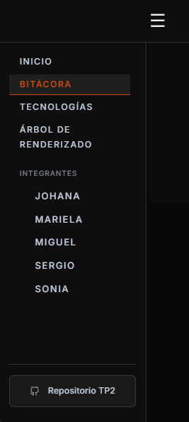
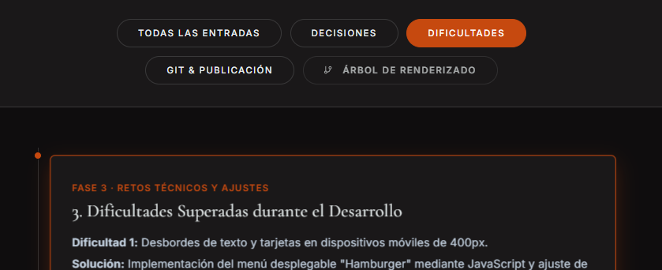
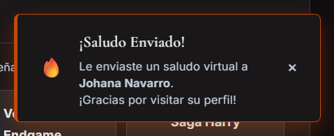
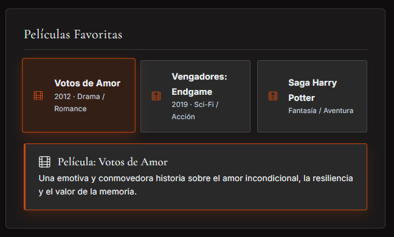

# Trabajo Práctico Grupal 2 - Equipo DataHell

Bienvenido/a al repositorio oficial del **Trabajo Práctico Grupal 2** para la materia "Desarrollo Web Frontend" del IFTS Nº 29.

---

## Índice de Contenidos

1. [Descripción del Proyecto](#1-descripción-del-proyecto)
2. [Integrantes del Equipo (Orden Alfabético)](#2-integrantes-del-equipo-orden-alfabético)
3. [Publicación y Despliegue en Producción](#3-publicación-y-despliegue-en-producción)
4. [Tecnologías y Librerías Utilizadas](#4-tecnologías-y-librerías-utilizadas)
5. [Árbol de Renderizado de Componentes (Jerarquía React)](#5-árbol-de-renderizado-de-componentes-jerarquía-react)
6. [Galería y Capturas de la Aplicación](#6-galería-y-capturas-de-la-aplicación)
7. [Funcionalidades Principales y Criterios de Evaluación](#7-funcionalidades-principales-y-criterios-de-evaluación)
8. [Metodología de Trabajo y Declaración de Uso de IA](#8-metodología-de-trabajo-y-declaración-de-uso-de-ia)
9. [Evolución Futura del Proyecto](#9-evolución-futura-del-proyecto)
10. [Instrucciones de Instalación y Ejecución Local](#10-instrucciones-de-instalación-y-ejecución-local)

---

## 1. Descripción del Proyecto

Este proyecto es la evolución natural de nuestro TP1. Hemos migrado nuestro sitio web estático hacia una **Single Page Application (SPA)** desarrollada con **React** y empaquetada con **Vite**.

El objetivo principal de esta iteración ha sido modularizar la interfaz en componentes reutilizables mediante *props*, abstraer la información en estructuras de datos JSON locales y gestionar estados complejos con Hooks (`useState`, `useEffect`, `useRef`). Hemos implementado una arquitectura de navegación dual (Header fijo + Sidebar retráctil accesible), consumo de datos locales parametrizados, un catálogo tecnológico con buscador reactivo y acordeón de información adicional, una sección interactiva para el árbol de renderizado y la integración con la API pública de GitHub con manejo de estados de carga, error y reintento.

---

## 2. Integrantes del Equipo (Orden Alfabético)

| Nombre y Apellido | Rol Principal | Ubicación | Perfil de GitHub / Redes |
| :--- | :--- | :--- | :--- |
| **Johana Navarro** | Lógica JS & Documentación / QA | Córdoba Capital (Córdoba) | [@johana-navarro](https://github.com/johana-navarro) | [LinkedIn](https://www.linkedin.com/in/johana-navarro184/) |
| **Mariela Lorenzo** | Diseño UI/UX & Código - Creativa | Boedo (CABA) | [@MariuLorenzo](https://github.com/MariuLorenzo) | [LinkedIn](https://www.linkedin.com/in/mariu-lorenzo/) |
| **Miguel Martínez** | Diseño Gráfico & Infraestructura IT | Bahía Blanca (BsAs) | [@mpmarcol](https://github.com/mpmarcol) |
| **Sergio Arenhardt** | Backend Dev & Bases de Datos | Eldorado (Misiones) | [@sealar24](https://github.com/sealar24) \| [LinkedIn](https://www.linkedin.com/in/sergio-alberto-arenhardt-8ba23a2a7/) |
| **Sonia Pereira** | Maquetado Web & Arquitectura | Belgrano (CABA) | [@SonyGahan](https://github.com/SonyGahan) |  [LinkedIn](https://www.linkedin.com/in/sonia-cpereira/) |

> **Nota de Coautoría:** El desarrollo, migración a React, diseño de componentes y documentación de este proyecto fue realizado de manera conjunta y coordinada por los 5 integrantes del equipo DataHell, reflejando el trabajo colaborativo en este repositorio institucional.

---

## 3. Publicación y Despliegue en Producción

* **Repositorio Oficial GitHub (TP2):** [https://github.com/cuartocuatrimestre2026-oss/TP2-FRONTEND-DATAHELL](https://github.com/cuartocuatrimestre2026-oss/TP2-FRONTEND-DATAHELL)
* **URL en Producción (Vercel):** [https://tp2-frontend-datahell.vercel.app/](https://tp2-frontend-datahell.vercel.app/)

*Nota de despliegue y rewrites:* Se ha configurado el archivo `vercel.json` en la raíz con reglas de reescritura (`"source": "/(.*)", "destination": "/index.html"`) para garantizar que la navegación nativa de React Router funcione correctamente al abrir y recargar directamente cualquier ruta interna (`/stack`, `/bitacora`, `/arbol`, `/perfil/:id`) sin arrojar errores 404 en el servidor de producción.

---

## 4. Tecnologías y Librerías Utilizadas

* **Core:** React 18 (Hooks: `useState`, `useEffect`, `useRef`) y Node.js.
* **Bundler & Build Tool:** Vite (entorno de desarrollo local ultrarrápido, HMR y compilación optimizada).
* **Enrutamiento:** `react-router-dom` (Navegación declarativa SPA basada en `<BrowserRouter>`, `<Routes>`, `<Route>`, `<Link>`, `useParams` y `useLocation`).
* **Iconografía Dinámica:** `lucide-react` (Renderizado SVG parametrizado y accesible).
* **Estilos:** CSS3 modularizado por componente y vistas, manteniendo la paleta de variables globales y la estética *tech-noir* (fondos oscuros, acentos `#c6490f`, alto contraste accesible WCAG AAA en textos de lectura y tipografía del sistema).

---

## 5. Árbol de Renderizado de Componentes (Jerarquía React)

Nuestra aplicación orquesta un único Virtual DOM desde `App.jsx`, con separación estricta de responsabilidades (UI, Datos, Lógica):

```text
<App> (Enrutador Principal & Estado elevado de menú)
  │
  ├── <ScrollToTop /> (Controlador de posición de ventana en cambio de ruta)
  ├── <Header /> (Cabecera fija superior con toggle accesible y Logotipo DataHell)
  │
  ├── <Contenedor Flex>
  │    ├── <Sidebar /> (Menú lateral retráctil "off-canvas" con enlaces de navegación)
  │    │
  │    └── <Routes> (Área de enrutamiento dinámico de vistas)
  │         ├── Ruta "/"           -> <Portada /> (Hero, contadores, frases, <MemberCard />, CTA)
  │         ├── Ruta "/bitacora"   -> <Bitacora /> (Línea de tiempo con scroll-spy y filtros)
  │         ├── Ruta "/stack"      -> <Tecnologias /> (Buscador, filtro, 21 tarjetas con acordeón)
  │         ├── Ruta "/perfil/:id" -> <Perfil /> (Vista paramétrica inteligente, toast, API GitHub)
  │         ├── Ruta "/arbol"      -> <ArbolRenderizado /> (Jerarquía interactiva expandible)
  │         └── Ruta "*"           -> <NotFound /> (Página 404 de respaldo accesible)
  │
  ├── <Footer /> (Pie de página institucional compartido)
  └── <BotonSubir /> (Botón flotante interactivo con detección de scroll)
```

---

## 6. Galería y Capturas de la Aplicación

A continuación se presentan capturas del funcionamiento de los componentes y vistas principales:

| Vista / Funcionalidad | Captura de Pantalla |
| :--- | :--- |
| **Menú Hamburguesa & Sidebar** |  |
| **Contadores Dinámicos de Portada** |  |
| **Generador de Frases del Equipo** |  |
| **Filtros Reactivos de Bitácora** |  |
| **Interacción Toast de Saludo en Perfil** |  |
| **Reseñas y Spoilers en Perfil** |  |

*(Nota: Las capturas pueden actualizarse con nuevas tomas antes de la entrega final).*

---

## 7. Funcionalidades Principales y Criterios de Evaluación

1. **Abstracción de Datos (JSON) y Componentización mediante Props (Criterios 04 y 10):**
   * Los datos personales de los integrantes se extrajeron al módulo `equipo.js`.
   * En la Portada, la renderización de las personas se modularizó en el componente reutilizable `<MemberCard />`, pasando la información de cada integrante a través de *props* dedicadas.
   * El catálogo tecnológico se gestiona desde `tecnologias_data.json` con **21 registros estructurados** (100% software, cubriendo Frontend, Backend, Mobile, Bases de Datos, QA & Testing y DevOps). Cada tarjeta cuenta con un acordeón interactivo que permite desplegar u ocultar información adicional (versión, licencia y uso en el proyecto), con cierre inteligente al hacer clic fuera o presionar la tecla `Escape`.
2. **Arquitectura de Navegación Dual y Completa (Criterios 05 y 06):**
   * Navegación compartida mediante `<Header>` fijo y `<Sidebar>` retráctil adaptada a dispositivos móviles con panel *off-canvas*.
   * Todas las pantallas disponen de controles internos de navegación (`Volver al Inicio`, anterior/siguiente) sin depender del botón Atrás del navegador.
   * La vista 404 (`<NotFound />`) captura cualquier ruta huérfana y orienta al usuario hacia la portada.
3. **Catálogo Tecnológico con Búsqueda y Filtros Combinados (Criterio 11):**
   * En la vista `/stack`, se aplica un filtrado dual reactivo (caja de búsqueda por texto + `<select>` de categorías) que opera en tiempo real.
   * Incluye estado de lista vacía (*empty state*) con mensaje explicativo y botón para reiniciar todos los filtros.
4. **Consumo de API Pública con Gestión Completa de Estados (Criterio 12):**
   * En `<Perfil />`, se consulta la API pública de GitHub (`api.github.com/users/{username}/repos`).
   * Posee indicador visual de carga (`cargandoRepos`), manejo de errores (`errorRepos`), botón en la interfaz para **Actualizar** en caliente y botón para **Reintentar conexión** ante contingencias.
5. **Árbol de Renderizado Interactivo (Criterio 13):**
   * Sección accesible desde la navegación (`/arbol`) que renderiza la jerarquía completa de componentes React.
   * Cada nodo principal permite **expandir y contraer** sus ramas hijas mediante controles interactivos `[+] / [-]` y botones globales para explorar la arquitectura de software.
6. **Bitácora de Desarrollo con Filtros Funcionales (Criterio 14):**
   * Registros cronológicos de decisiones, acuerdos y dificultades técnicas consumidos desde `bitacora.json`.
   * Botonera organizada en dos renglones con filtros reactivos por categoría y mecanismo de *Scroll-Spy* implementado con hooks (`useRef` y `useEffect`).

---

## 8. Metodología de Trabajo y Declaración de Uso de IA

El equipo ejerció la autoría, diseño de experiencia de usuario (UX/UI), arquitectura de componentes y toma de decisiones técnicas, utilizando herramientas de Inteligencia Artificial para asistencia en depuración de errores, traducción de patrones imperativos a declarativos de React y optimización de código.

### Discriminación de Herramientas y Modelos Utilizados (Criterio 15)

* **Entornos / Aplicaciones utilizadas:**
  1. **Google Antigravity IDE:** Entorno de desarrollo interactivo asistido por agentes.
  2. **Google Gemini Web:** Interfaz web para consultas teóricas rápidas y redacción de borradores.
* **Modelos de Inteligencia Artificial empleados:**
  1. **Gemini 1.5 Pro / 2.5 Pro:** Utilizados para análisis profundo de código, arquitectura de componentes React, auditoría de accesibilidad WCAG y depuración de dependencias.
  2. **Claude 3.5 Sonnet:** Utilizado dentro de Antigravity IDE para refactorización de lógica asíncrona y estructuración de estados complejos.
  3. **Gemini Estándar (Web):** Utilizado para asistencia en redacción conceptual y documentación de bitácora.

### Matriz de Uso de IA por Integrante

| Integrante | Rol en el Proyecto | Aplicación Utilizada | Modelos Empleados | Tareas Específicas Asistidas por IA |
| :--- | :--- | :--- | :--- | :--- |
| **Johana Navarro** | Lógica JS & Documentación / QA | Antigravity IDE & Gemini Web | Gemini Pro / Gemini Web | Auditoría integral de cumplimiento de consignas, análisis de accesibilidad AAA, redacción de documentación técnica y estructura de la bitácora. |
| **Mariela Lorenzo** | Diseño UI/UX & Código Creativo | Antigravity IDE | Claude 3.5 Sonnet / Gemini Pro | Exploración de patrones visuales tech-noir, microinteracciones (animaciones Toast, modales accesibles) y diseño interactivo de tarjetas. |
| **Miguel Martínez** | Infraestructura IT & Gráfica | Antigravity IDE & Gemini Web | Gemini Pro / Gemini Web | Configuración del empaquetador Vite, diagnóstico de dependencias locales, optimización de assets gráficos y reglas de rewrites en `vercel.json`. |
| **Sergio Arenhardt** | Backend Dev & Bases de Datos | Antigravity IDE | Claude 3.5 Sonnet / Gemini Pro | Modelado del esquema de datos JSON (21 tecnologías), lógica de consumo asíncrono de la API de GitHub con estados de reintento y filtros combinados. |
| **Sonia Pereira** | Maquetado Web & Arquitectura | Antigravity IDE | Gemini Pro | Maquetado de la navegación dual (Header fijo + Sidebar off-canvas), diagrama jerárquico del árbol de componentes React y maquetado de perfiles. |

---

## 9. Evolución Futura del Proyecto

1. **Estado Global con Context API:** Centralizar la gestión del tema visual (Light/Dark mode) y preferencias de accesibilidad sin prop-drilling.
2. **Paginación y Virtualización:** Si el catálogo de tecnologías supera los 100 registros, integrar virtualización de listas (*react-window*) para optimizar el rendimiento de renderizado.
3. **Persistencia Local (LocalStorage):** Almacenar las preferencias de búsqueda del usuario y registros leídos de la bitácora.

---

## 10. Instrucciones de Instalación y Ejecución Local

1. **Clonar el repositorio:**
   ```bash
   git clone https://github.com/cuartocuatrimestre2026-oss/TP2-FRONTEND-DATAHELL.git
   cd TP2-FRONTEND-DATAHELL
   ```
2. **Instalar dependencias:**
   ```bash
   npm install
   ```
3. **Iniciar el servidor de desarrollo:**
   ```bash
   npm run dev
   ```
   Abrir en el navegador: `http://localhost:5173/`

4. **Compilar para producción:**
   ```bash
   npm run build
   ```
