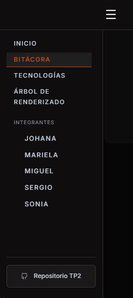
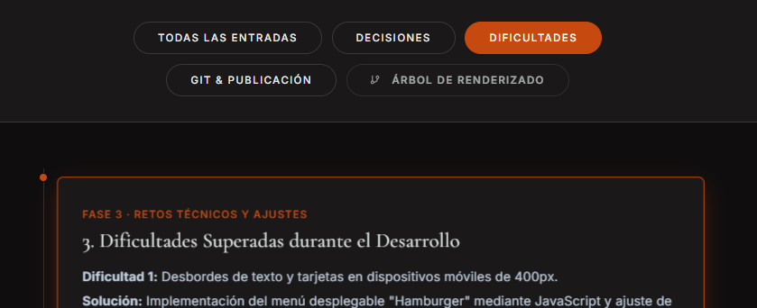
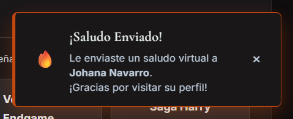
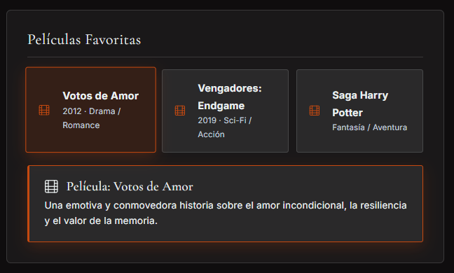

# Trabajo Práctico Grupal 2 - Equipo DataHell

Bienvenido/a al repositorio oficial del **Trabajo Práctico Grupal 2** para la materia "Desarrollo Web Frontend" del IFTS Nº 29.

---

## Índice de Contenidos

1. [Descripción del Proyecto](#1-descripción-del-proyecto)
2. [Integrantes del Equipo (Orden Alfabético)](#2-integrantes-del-equipo-orden-alfabético)
3. [Publicación y Despliegue en Producción](#3-publicación-y-despliegue-en-producción)
4. [Tecnologías y Librerías Utilizadas](#4-tecnologías-y-librerías-utilizadas)
5. [Árbol de Renderizado de Componentes (Jerarquía React)](#5-árbol-de-renderizado-de-componentes-jerarquía-react)
6. [Galería y Capturas de la Aplicación](#6-galería-y-capturas-de-la-aplicación)
7. [Funcionalidades Principales y Criterios de Evaluación](#7-funcionalidades-principales-y-criterios-de-evaluación)
8. [Metodología de Trabajo y Declaración de Uso de IA](#8-metodología-de-trabajo-y-declaración-de-uso-de-ia)
9. [Evolución Futura del Proyecto](#9-evolución-futura-del-proyecto)
10. [Instrucciones de Instalación y Ejecución Local](#10-instrucciones-de-instalación-y-ejecución-local)

---

## 1. Descripción del Proyecto

Este proyecto es la evolución natural de nuestro TP1. Hemos migrado nuestro sitio web estático hacia una **Single Page Application (SPA)** desarrollada con **React** y empaquetada con **Vite**.

El objetivo principal de esta iteración ha sido modularizar la interfaz en componentes reutilizables mediante *props*, abstraer la información en estructuras de datos JSON locales y gestionar estados complejos con Hooks (`useState`, `useEffect`, `useRef`). Hemos implementado una arquitectura de navegación dual (Header fijo + Sidebar retráctil accesible), consumo de datos locales parametrizados, un catálogo tecnológico con buscador reactivo y acordeón de información adicional, una sección interactiva para el árbol de renderizado y la integración con la API pública de GitHub con manejo de estados de carga, error y reintento.

---

## 2. Integrantes del Equipo (Orden Alfabético)

| Nombre y Apellido | Rol Principal | Ubicación | Perfil de GitHub / Redes |
| :--- | :--- | :--- | :--- |
| **Johana Navarro** | Lógica JS & Documentación / QA | Córdoba Capital (Córdoba) | [@johana-navarro](https://github.com/johana-navarro) \| [LinkedIn](https://www.linkedin.com/in/johana-navarro184/) |
| **Mariela Lorenzo** | Diseño UI/UX & Código - Creativa | Boedo (CABA) | [@MariuLorenzo](https://github.com/MariuLorenzo) \| [LinkedIn](https://www.linkedin.com/in/mariu-lorenzo/) |
| **Miguel Martínez** | Diseño Gráfico & Infraestructura IT | Bahía Blanca (BsAs) | [@mpmarcol](https://github.com/mpmarcol) |
| **Sergio Arenhardt** | Backend Dev & Bases de Datos | Eldorado (Misiones) | [@sealar24](https://github.com/sealar24) \| [LinkedIn](https://www.linkedin.com/in/sergio-alberto-arenhardt-8ba23a2a7/) |
| **Sonia Pereira** | Maquetado Web & Arquitectura | Belgrano (CABA) | [@SonyGahan](https://github.com/SonyGahan) \| [LinkedIn](https://www.linkedin.com/in/sonia-cpereira/) |

> **Nota de Coautoría:** El desarrollo, migración a React, diseño de componentes y documentación de este proyecto fue realizado de manera conjunta y coordinada por los 5 integrantes del equipo DataHell, reflejando el trabajo colaborativo en este repositorio institucional.

---

## 3. Publicación y Despliegue en Producción

* **Repositorio Oficial GitHub (TP2):** [https://github.com/cuartocuatrimestre2026-oss/TP2-FRONTEND-DATAHELL](https://github.com/cuartocuatrimestre2026-oss/TP2-FRONTEND-DATAHELL)
* **URL en Producción (Vercel):** [https://tp2-frontend-datahell.vercel.app/](https://tp2-frontend-datahell.vercel.app/)

*Nota de despliegue y rewrites:* Se ha configurado el archivo `vercel.json` en la raíz con reglas de reescritura (`"source": "/(.*)", "destination": "/index.html"`) para garantizar que la navegación nativa de React Router funcione correctamente al abrir y recargar directamente cualquier ruta interna (`/stack`, `/bitacora`, `/arbol`, `/perfil/:id`) sin arrojar errores 404 en el servidor de producción.

---

## 4. Tecnologías y Librerías Utilizadas

* **Core:** React 18 (Hooks: `useState`, `useEffect`, `useRef`) y Node.js.
* **Bundler & Build Tool:** Vite (entorno de desarrollo local ultrarrápido, HMR y compilación optimizada).
* **Enrutamiento:** `react-router-dom` (Navegación declarativa SPA basada en `<BrowserRouter>`, `<Routes>`, `<Route>`, `<Link>`, `useParams` y `useLocation`).
* **Iconografía Dinámica:** `lucide-react` (Renderizado SVG parametrizado y accesible).
* **Estilos:** CSS3 modularizado por componente y vistas, manteniendo la paleta de variables globales y la estética *tech-noir* (fondos oscuros, acentos `#c6490f`, alto contraste accesible WCAG AAA en textos de lectura y tipografía del sistema).

---

## 5. Árbol de Renderizado de Componentes (Jerarquía React)

Nuestra aplicación orquesta un único Virtual DOM desde `App.jsx`, con separación estricta de responsabilidades (UI, Datos, Lógica):

```text
<App> (Enrutador Principal & Estado elevado de menú)
  │
  ├── <ScrollToTop /> (Controlador de posición de ventana en cambio de ruta)
  ├── <Header /> (Cabecera fija superior con toggle accesible y Logotipo DataHell)
  │
  ├── <Contenedor Flex>
  │    ├── <Sidebar /> (Menú lateral retráctil "off-canvas" con enlaces de navegación)
  │    │
  │    └── <Routes> (Área de enrutamiento dinámico de vistas)
  │         ├── Ruta "/"           -> <Portada /> (Hero, contadores, frases, <MemberCard />, CTA)
  │         ├── Ruta "/bitacora"   -> <Bitacora /> (Línea de tiempo con scroll-spy y filtros)
  │         ├── Ruta "/stack"      -> <Tecnologias /> (Buscador, filtro, 21 tarjetas con acordeón)
  │         ├── Ruta "/perfil/:id" -> <Perfil /> (Vista paramétrica inteligente, toast, API GitHub)
  │         ├── Ruta "/arbol"      -> <ArbolRenderizado /> (Jerarquía interactiva expandible)
  │         └── Ruta "*"           -> <NotFound /> (Página 404 de respaldo accesible)
  │
  ├── <Footer /> (Pie de página institucional compartido)
  └── <BotonSubir /> (Botón flotante interactivo con detección de scroll)
```

---

## 6. Galería y Capturas de la Aplicación

A continuación se presentan capturas del funcionamiento de los componentes y vistas principales:

| Vista / Funcionalidad | Captura de Pantalla |
| :--- | :--- |
| **Menú Hamburguesa & Sidebar** |  |
| **Contadores Dinámicos de Portada** |  |
| **Generador de Frases del Equipo** |  |
| **Filtros Reactivos de Bitácora** |  |
| **Interacción Toast de Saludo en Perfil** |  |
| **Reseñas y Spoilers en Perfil** |  |

*(Nota: Las capturas pueden actualizarse con nuevas tomas antes de la entrega final).*

---

## 7. Funcionalidades Principales y Cumplimiento de Criterios (Nivel SUPERA)

Nuestra aplicación implementa los 15 criterios de evaluación en sus niveles más altos (**Propone** y **Supera**), integrando microinteracciones, persistencia en `localStorage` y recursos multimedia reales:

1. **Gestión de Repositorio y Publicación (Criterio 01 - Propone):** Repositorio público e independiente con descripción del proyecto y acceso directo al despliegue en Vercel.
2. **README Técnico Integral (Criterio 02 - Propone):** Documentación exhaustiva con índice de navegación interno, descripción del proyecto, integrantes, capturas de pantalla y guía técnica.
3. **Integrantes y Responsabilidades (Criterio 03 - Propone):** Identificación precisa de roles, especialidades y tareas técnicas de cada miembro del equipo.
4. **Arquitectura React & Componentización mediante Props (Criterio 04 - Propone):** Modularización en componentes reutilizables (`<MemberCard />`, `<NodoComponente />`, `<Header />`, `<Sidebar />`) parametrizados mediante *props* y renderizados a partir de datos estructurados.
5. **Sidebar Compartida & Accesible (Criterio 05 - Propone):** Menú lateral *off-canvas* compartido entre todas las vistas con detección de ruta activa (`useLocation`), soporte para teclado (`Escape`) y cierre táctil en móviles.
6. **Navegación Fluida & Resiliencia (Criterio 06 - Propone):** Todas las pantallas ofrecen navegación interna (`Volver al Inicio`, anterior/siguiente) sin depender del botón Atrás. Configuración de `vercel.json` con *rewrites* para recarga directa de cualquier URL sin error 404.
7. **Portada Interactiva con Filtro por Especialidades (Criterio 07 - Propone):** Presentación del equipo con contadores dinámicos animados (`requestAnimationFrame`), generador de frases y **barra interactiva de filtrado de integrantes por área** (`Frontend & UI`, `Backend & Datos`, `Diseño & Creatividad`, `QA & DevOps`).
8. **Perfiles Dinámicos con Reproductor de Audio Real (Criterio 08 - Supera):**
   * **Reproductor multimedia de audio real:** Al seleccionar un disco favorito de un integrante, la aplicación reproduce una **muestra sonora oficial de 30 segundos (AAC/m4a)** con carátula oficial del álbum, botón interactivo Play/Pause, barra de progreso y ecualizador animado de ondas de sonido.
   * **Compartir perfil:** Botón para copiar el enlace directo al portapapeles (`navigator.clipboard`) con notificación Toast animada.
   * **Navegación rápida de equipo:** Barra circular con los avatares de los 5 integrantes para saltar directamente a cualquier compañero sin salir del perfil.
   * **Reseñas desplegables:** Apertura y cierre de sinopsis cinematográficas y críticas musicales.
9. **Identidad Visual Integral & Modo Claro / Modo Oscuro (Criterio 09 - SUPERA):**
   * **Tema Dual Dinámico (Dark / Light):** Selector accesible en la cabecera fija que alterna entre la estética *tech-noir* original (`#0f0d0e`) y una paleta *editorial paper* cálida (`#f6f3ef`), con persistencia en `localStorage` (`datahell-theme`) y transición suave de CSS Variables.
   * **Iconografía SVG y tipografía:** Combinación armónica de fuentes de Google Fonts (*Cormorant Garamond* e *Inter*) e íconos interactivos de `lucide-react`.
10. **Datos Locales JSON Parametrizados (Criterio 10 - Propone):** Catálogo estructurado en `tecnologias_data.json` con **21 registros** de software organizados por categoría, con acordeón interactivo que despliega detalles técnicos (versión, licencia y uso).
11. **Búsqueda, Filtro, Favoritos y Ordenamiento (Criterio 11 - Supera):**
    * Búsqueda reactiva por texto libre en tiempo real.
    * Selector de categorías con actualización instantánea.
    * **Sistema de Favoritos persistente (`localStorage`):** Posibilidad de marcar herramientas con estrella (`★`) y filtrar por *Solo Favoritas*.
    * **Selector de ordenamiento:** Ordenar por `Nombre (A → Z)`, `Nombre (Z → A)` o `Por Categoría`.
    * **Contador dinámico:** Muestra cantidad exacta de resultados filtrados y estado de lista vacía (*empty state*) con botón para restablecer filtros.
12. **Consumo de API Pública con Resiliencia (Criterio 12 - Propone):** Integración con la API pública de GitHub (`api.github.com/users/{username}/repos`) en la vista de perfil, con estados visuales de carga, manejo explícito de errores y botones para **Actualizar** o **Reintentar conexión** en caliente.
13. **Árbol de Renderizado con Buscador en Vivo (Criterio 13 - Propone):** Vista `/arbol` interactiva que expone la jerarquía completa del Virtual DOM, con botones para expandir/colapsar ramas y **buscador en tiempo real** que resalta componentes, props y estados coincidentes.
14. **Bitácora de Desarrollo con Scroll-Spy y Filtros (Criterio 14 - Propone):** Línea de tiempo cronológica con filtros por categoría (`Decisiones`, `Dificultades`, `Git`) y detección de scroll para resaltar la entrada en foco.
15. **Declaración Analítica de Uso de IA (Criterio 15 - Propone):** Matriz detallada que discrimina por cada integrante las aplicaciones (Antigravity IDE, Gemini Web), modelos (Gemini 1.5/2.5 Pro, Claude 3.5 Sonnet) y tareas técnicas asistidas.
16. **Creatividad & Gamificación Interactiva (Nivel SUPERA - DataHell Runner):** Minijuego arcade desarrollado desde cero en HTML5 `<canvas>`, accesible en la ruta `/game`, en el menú de navegación y embebido en la página `404`. Rinde homenaje al clásico dino runner offline de Chrome bajo la premisa: *'¿Te sobró tiempo entre despliegues? El clásico juego de cuando te quedás sin internet... pero con internet y esquivando bugs de DataHell'*. Cuenta con:
    * Física fluida de saltos y colisiones pixel-perfect.
    * Generación procedural de obstáculos (bugs de código, fallas de base de datos y servidores caídos).
    * Efectos de sonido retro 8-bit sintetizados en tiempo real mediante la **Web Audio API** nativa (0 dependencias externas).
    * Sistema de partículas y efectos visuales adaptados a modo claro y modo oscuro.
    * Puntuación en tiempo real y persistencia del récord de puntaje (*High Score*) en `localStorage`.

---

## 8. Metodología de Trabajo y Declaración de Uso de IA

El equipo ejerció la autoría, diseño de experiencia de usuario (UX/UI), arquitectura de componentes y toma de decisiones técnicas, utilizando herramientas de Inteligencia Artificial para asistencia en depuración de errores, traducción de patrones imperativos a declarativos de React y optimización de código.

### Discriminación de Herramientas y Modelos Utilizados (Criterio 15)

* **Entornos / Aplicaciones utilizadas:**
  1. **Google Antigravity IDE:** Entorno de desarrollo interactivo asistido por agentes.
  2. **Google Gemini Web:** Interfaz web para consultas teóricas rápidas y redacción de borradores.
* **Modelos de Inteligencia Artificial empleados:**
  1. **Gemini 1.5 Pro / 2.5 Pro:** Utilizados para análisis profundo de código, arquitectura de componentes React, auditoría de accesibilidad WCAG y depuración de dependencias.
  2. **Claude 3.5 Sonnet:** Utilizado dentro de Antigravity IDE para refactorización de lógica asíncrona y estructuración de estados complejos.
  3. **Gemini Estándar (Web):** Utilizado para asistencia en redacción conceptual y documentación de bitácora.

### Matriz de Uso de IA por Integrante

| Integrante | Rol en el Proyecto | Aplicación Utilizada | Modelos Empleados | Tareas Específicas Asistidas por IA |
| :--- | :--- | :--- | :--- | :--- |
| **Johana Navarro** | Lógica JS & Documentación / QA | Antigravity IDE & Gemini Web | Gemini Pro / Gemini Web | Auditoría integral de cumplimiento de consignas, análisis de accesibilidad AAA, redacción de documentación técnica y estructura de la bitácora. |
| **Mariela Lorenzo** | Diseño UI/UX & Código Creativo | Antigravity IDE | Claude 3.5 Sonnet / Gemini Pro | Exploración de patrones visuales tech-noir, microinteracciones (animaciones Toast, modales accesibles) y diseño interactivo de tarjetas. |
| **Miguel Martínez** | Infraestructura IT & Gráfica | Antigravity IDE & Gemini Web | Gemini Pro / Gemini Web | Configuración del empaquetador Vite, diagnóstico de dependencias locales, optimización de assets gráficos y reglas de rewrites en `vercel.json`. |
| **Sergio Arenhardt** | Backend Dev & Bases de Datos | Antigravity IDE | Claude 3.5 Sonnet / Gemini Pro | Modelado del esquema de datos JSON (21 tecnologías), lógica de consumo asíncrono de la API de GitHub con estados de reintento y filtros combinados. |
| **Sonia Pereira** | Maquetado Web & Arquitectura | Antigravity IDE | Gemini Pro | Maquetado de la navegación dual (Header fijo + Sidebar off-canvas), diagrama jerárquico del árbol de componentes React y maquetado de perfiles. |

---

## 9. Evolución Futura del Proyecto

1. **Estado Global con Context API:** Centralizar la gestión del tema visual (Light/Dark mode) y preferencias de accesibilidad sin prop-drilling.
2. **Paginación y Virtualización:** Si el catálogo de tecnologías supera los 100 registros, integrar virtualización de listas (*react-window*) para optimizar el rendimiento de renderizado.
3. **Persistencia Local (LocalStorage):** Almacenar las preferencias de búsqueda del usuario y registros leídos de la bitácora.

---

## 10. Instrucciones de Instalación y Ejecución Local

1. **Clonar el repositorio:**
   ```bash
   git clone https://github.com/cuartocuatrimestre2026-oss/TP2-FRONTEND-DATAHELL.git
   cd TP2-FRONTEND-DATAHELL
   ```
2. **Instalar dependencias:**
   ```bash
   npm install
   ```
3. **Iniciar el servidor de desarrollo:**
   ```bash
   npm run dev
   ```
   Abrir en el navegador: `http://localhost:5173/`

4. **Compilar para producción:**
   ```bash
   npm run build
   ```
